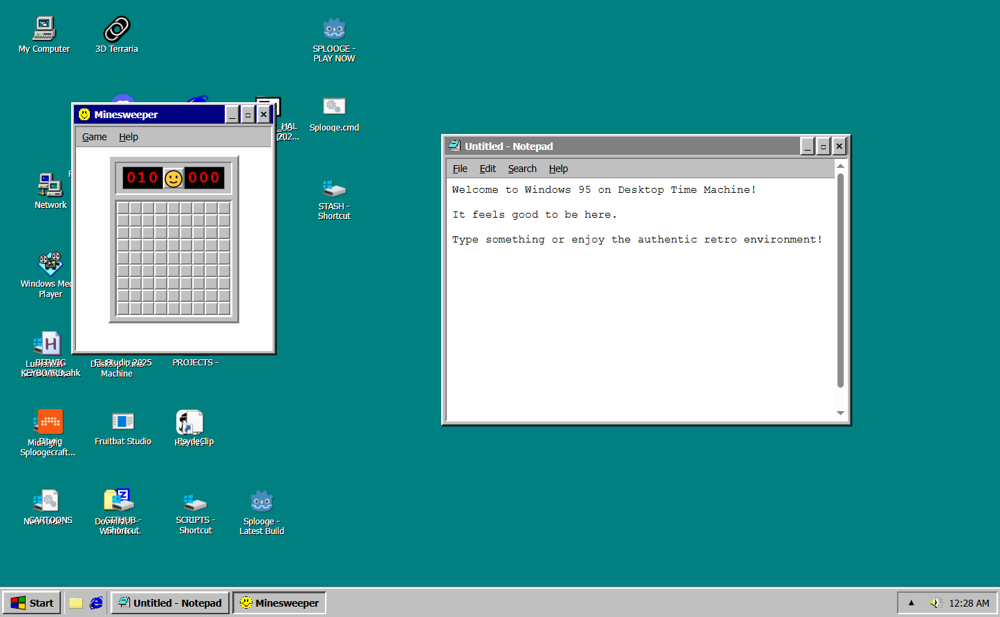
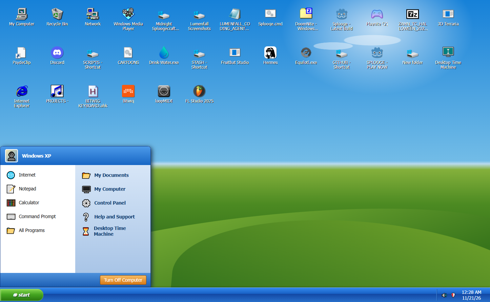
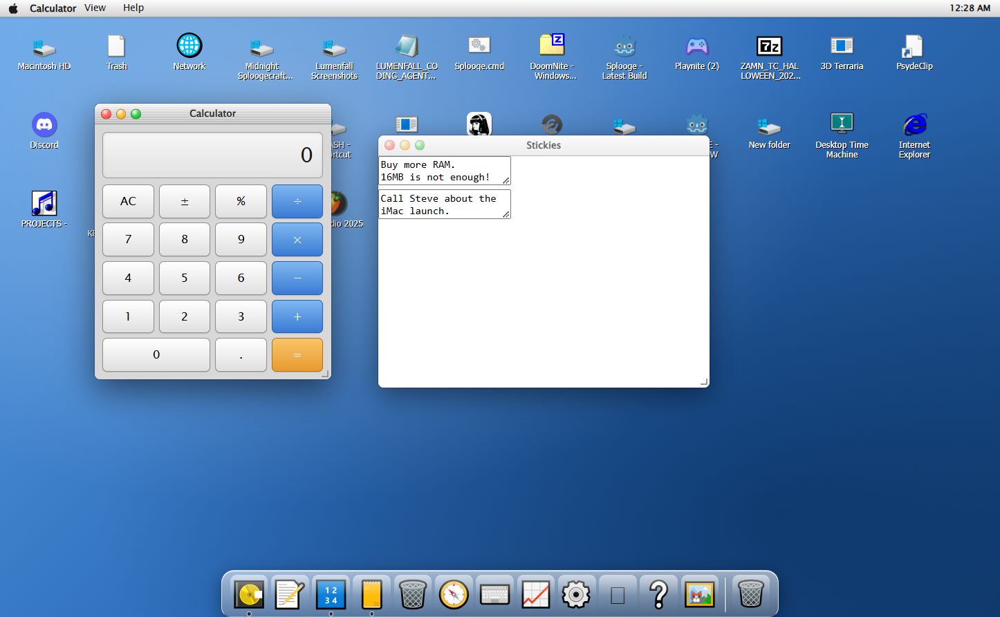

# Desktop Time Machine ⏳

> **A modular retro-computing simulator for Windows 10 and Windows 11.**

Desktop Time Machine turns a modern Windows machine into a museum of historically inspired operating systems. Each era is a self-contained **presentation** of the same computer with its own applications and personality; a shared engine supplies capabilities such as real filesystem access, window management and live desktop mirroring.

**One computer. One underlying environment. Multiple historical presentations.** Switching skins changes how the computer looks and feels — never which files, user data or applications it has. Skins may store visual preferences (wallpaper, icon layout, screensaver); files and application data stay on the single real host filesystem.

---

## 🖥️ A Tour Through Time

| Windows 95 · 1995 | Windows XP · 2001 | Mac OS X · 2001 |
|:---:|:---:|:---:|
|  |  |  |

Screenshots are captured from the real application by `npm run screenshots`.

---

## 🌟 Available operating systems

All nine skins are registered and loadable:

- **Windows 95 (1995)** — teal desktop, Start menu, grey 3D bevels, taskbar, Notepad, Paint, Minesweeper, Display Properties, DOOM launcher and a limited Command Prompt.
- **Windows 98 (1998)** — Active Desktop styling, Quick Launch, Explorer, Paint, Minesweeper and a two-column Start menu.
- **Windows XP (2001)** — Luna desktop, two-column Start menu, taskbar grouping and Explorer-style browsing.
- **Mac OS 8 (1997)** — Platinum interface, Apple menu, Control Strip, window shading, SimpleText and Stickies.
- **Mac OS X (2001)** — Aqua menu bar and Dock, Finder over real host files, Calculator, Terminal and a Safari window backed by a real embedded browser view.
- **Amiga Workbench 3.1 (1992)** — screen bar, disk/drawer icons, Intuition-style windows and AmigaShell.
- **BeOS R5 (2000)** — Deskbar, tabbed windows, Tracker and four workspaces.
- **TempleOS (2013)** — 640×480 sixteen-colour display and a HolyC-inspired command prompt.
- **Messenger 7 (2003, experimental)** — a contact-list window and taskbar. Discord opens as a contact in a Messenger-styled window, with an optional "Messenger look" accent toggle. Original styling only; no vendor artwork.

The **Era Switcher** (`F8`) shows the full gallery and remembers the selection between launches. Personal settings such as desktop icon positions are stored per skin.

### Shared engine capabilities

- **Real Windows integration** — browse and manage actual host files from every skin; open files with their Windows default application.
- **Desktop mirror** — the user's real desktop icons, Recycle Bin, drives and network locations are rendered inside each retro desktop with live filesystem updates.
- **Shell integration** — pinned taskbar items, running windows, the notification area and volume controls are mirrored where the host supports them.
- **External browsing** — the retro Internet Explorer uses a real, separately installed Chromium browser profile.

The shared engine provides capabilities; each skin owns its appearance, applications and behaviour.

---

## 🚀 Setup and development

### Prerequisites

- Node.js 18 or newer
- npm
- Windows 10 or Windows 11 (the real filesystem and shell integrations are Windows-only)
- Electron is installed as a dev dependency by `npm install`

### Commands

```powershell
# From the repository root
npm install
npm start          # Launch the Electron application
npm test           # Full verification suite (all skins, security, switching)
npm run screenshots  # Regenerate the gallery screenshots
```

Additional focused suites can be run directly:

```powershell
npx electron test/security-regressions.js
npx electron test/phase4-security.js
npx electron test/phase4-skins.js
npx electron test/mirror-smoke.js
```

### Browser development mode

Opening `src/index.html` in an ordinary browser works for UI work. In that mode there is no Electron preload bridge: the engine substitutes an in-memory mock filesystem, so files, shell integration and live desktop updates are **not** real. Only Electron mode exercises host integration.

### Real browser engine

The retro Internet Explorer is a real Ungoogled Chromium window on a private profile. On a machine without it, the app provisions it on first launch by downloading the official Windows installer, running it silently for the current user and creating an **Internet Explorer** shortcut. Existing shortcuts are never replaced.

For an offline copy, place one of these files in `resources/` before copying the folder:

```
resources/
  ungoogled-chromium-installer-x64.exe
  ungoogled-chromium_<version>_installer_x64.exe
```

`DTM_CHROMIUM_INSTALLER` points at an installer anywhere on disk; `DTM_CHROMIUM` points at an existing `chrome.exe` and skips provisioning.

---

## ⌨️ Shortcuts & controls

| Action | Shortcut / trigger |
|---|---|
| Open Era Switcher | <kbd>F8</kbd> (also <kbd>Ctrl+Shift+T</kbd> in skins that forward it) |
| Switch era from inside a skin | Double-click the ⏳ Time Machine icon or use its Start-menu entry |
| Toggle fullscreen | <kbd>Ctrl+F5</kbd>, or double-click the taskbar tray/clock |
| Window shading (Mac OS 8) | Double-click the window title bar |
| Safe exit to Windows | Start menu → Shut Down → Turn Off |

---

## 🛡️ Security model

- `contextIsolation: true`, `nodeIntegration: false` and a frozen `contextBridge` preload; renderer code cannot import Node.js or Electron modules.
- Every IPC channel is restricted to the application's own `file://` origin. Remote webview guests cannot invoke filesystem or shell handlers.
- The preload's event subscription is limited to the two desktop-update channels the app actually uses.
- Host programs are restricted to four pinned system binaries: `notepad.exe`, `calc.exe`, `mspaint.exe` and `explorer.exe`. No shell is spawned for program launches.
- The in-skin Command Prompt implements a small allowlisted command set in the main process; it never evaluates renderer input in PowerShell.
- Filesystem paths are normalized and resolved through their real ancestors before validation; device namespaces, UNC paths, 8.3 short names, reserved device names, junctions into protected trees and credential directories are rejected. Destructive operations additionally protect system and profile roots.
- External URLs must be `http:` or `https:` with a hostname. The same rule applies to the external browser engine; local `file:` URLs are not accepted from renderer input.
- Guest webviews are hardened (sandboxed, no preload, no popups, http(s) navigation only).
- No permission is granted automatically. Camera, microphone, geolocation, notifications, clipboard and display capture are denied unless a user grants them through a system prompt. Screen sharing uses the operating-system picker; the app never silently selects a source.

Filesystem access is **real host access**, not a sandboxed virtual disk. Treat skins as trusted application code; the boundary protects against accidental or injected renderer misuse, not against a malicious local installation.

---

## 📚 Documentation

- [Architecture & process model](docs/ARCHITECTURE.md)
- [Skin development guide](docs/SKIN_DEVELOPMENT.md)
- [Skin SDK](docs/SKIN_SDK.md)
- [Skin manifest specification](docs/SKIN_MANIFEST_SPEC.md)
- [LLM skin generation guide](docs/LLM_SKIN_GENERATION.md)
- [Phase 2 report](PHASE_2_REPORT.md) · [Phase 3 report](PHASE_3_REPORT.md)
